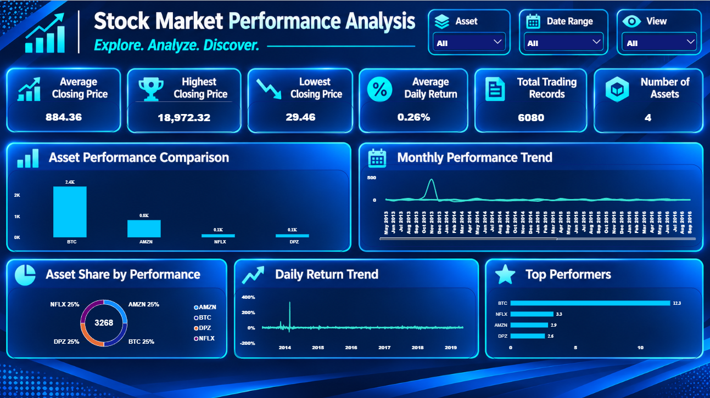
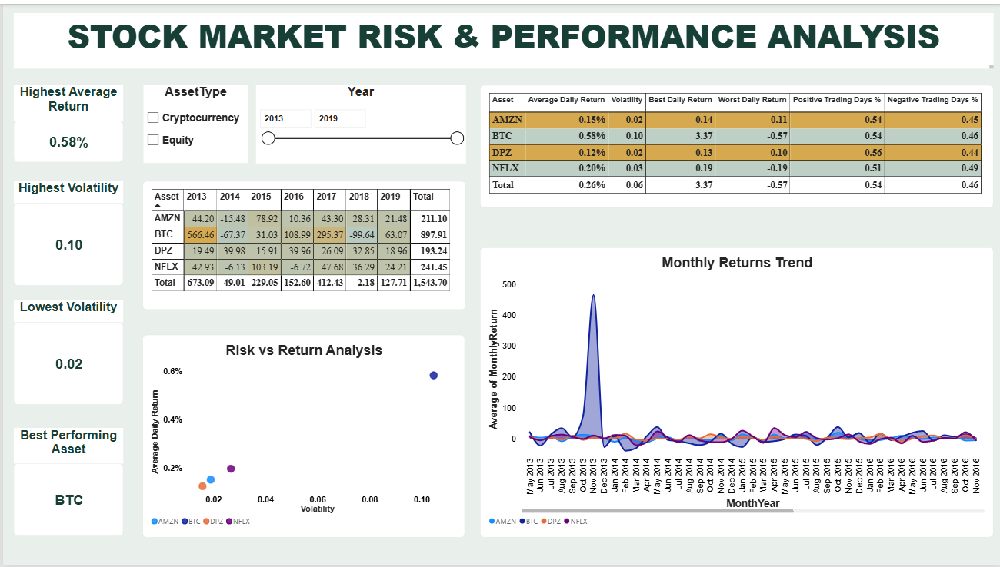
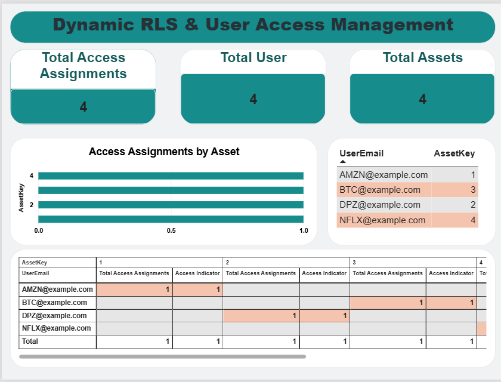

# Stock-Market-Performance-Analysis-Copy
A data analytics project analyzing historical stock market performance and risk using Excel, MySQL, and Power BI.

# Stock Market Performance & Risk Analysis

## Project Overview
This project analyzes historical stock market data for four assets: Amazon (AMZN), Bitcoin (BTC), Domino's Pizza (DPZ), and Netflix (NFLX).

The project uses Microsoft Excel, MySQL, and Power BI to explore price movements, calculate returns, compare asset performance, and evaluate investment risk.

**Dataset:** 1,520 historical records  
**Period:** May 2013 – May 2019

## Tools & Technologies
- Microsoft Excel
- MySQL
- Power BI
- DAX

## Project Workflow

### 1. Excel Analysis
- Organized raw and working datasets.
- Calculated daily percentage changes.
- Performed statistical analysis.
- Created Pivot Tables and charts.
- Compared average prices and daily performance.

### 2. SQL Analysis
- Imported and queried stock market data using MySQL.
- Analyzed monthly and yearly average prices.
- Identified the top positive and negative daily movements.
- Calculated asset volatility.
- Used CTEs, subqueries, aggregate functions, and window functions to rank assets.

### 3. Power BI Dashboard
Created three interactive dashboard pages:

**Page 1 – Market Overview**
- KPI cards and asset comparisons.
- Monthly performance trends.
- Positive trading days analysis.
- Daily return trends.
- Interactive slicers and field parameters.

**Page 2 – Asset Performance Analysis**
- Risk vs Return scatter chart.
- Monthly returns trend.
- Yearly asset performance matrix.
- Volatility and return comparisons.

**Page 3 – Dynamic Row-Level Security & User Access Management**
- Dynamic RLS using DAX.
- User-to-asset access mapping.
- User permission matrix.
- Access assignment analysis.

## Key Findings
- Bitcoin (BTC) recorded the highest average daily return and volatility.
- Domino's Pizza (DPZ) recorded the lowest volatility among the four assets.
- The analysis demonstrates the relationship between historical returns and risk.

## Dashboard Previews

### Page 1 – Market Overview

### Page 2 – Asset Performance Analysis

### Page 3 – Dynamic RLS & User Access Management

## Skills Demonstrated
- Data Cleaning and Preparation
- Exploratory Data Analysis
- Excel Formulas and Pivot Tables
- MySQL Querying
- Statistical Analysis
- DAX Measures
- Data Modeling
- Power BI Dashboard Development
- Dynamic Row-Level Security

## Disclaimer
This project is for educational and portfolio purposes only. It uses historical data from May 2013 to May 2019 and does not represent current market performance or investment advice.

## Author
**Sathish D**  
Aspiring Data Analyst
